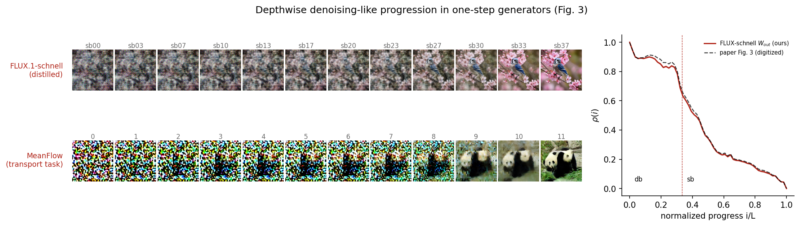
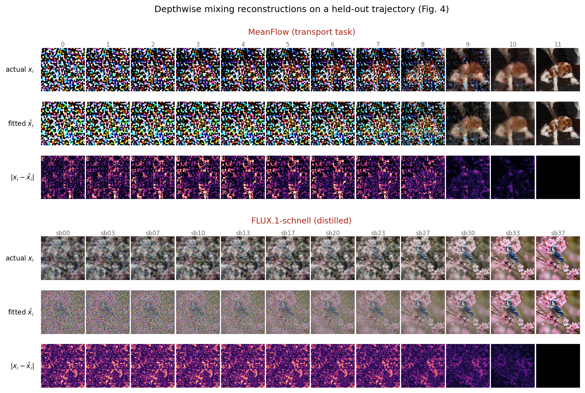
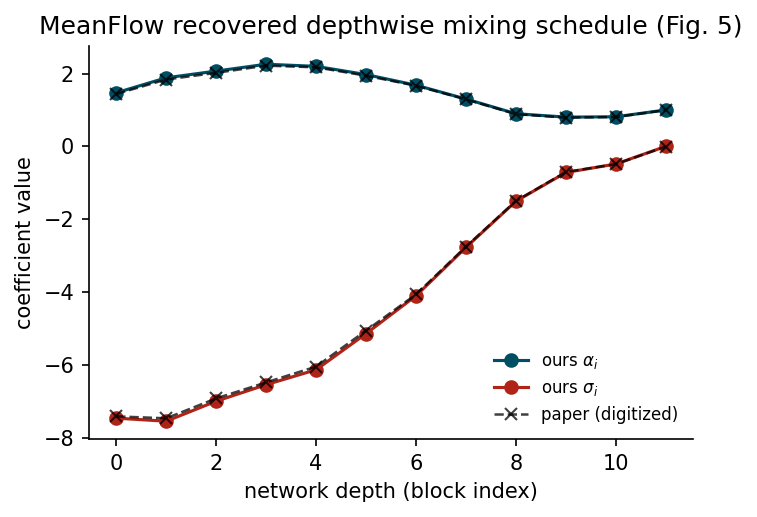
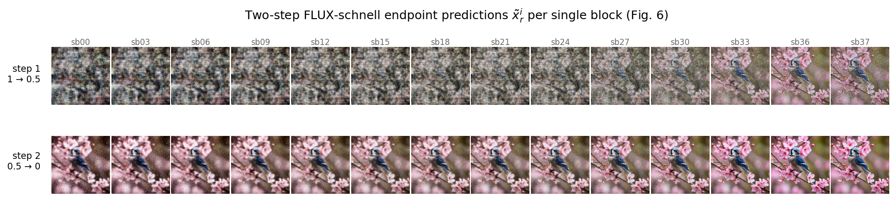
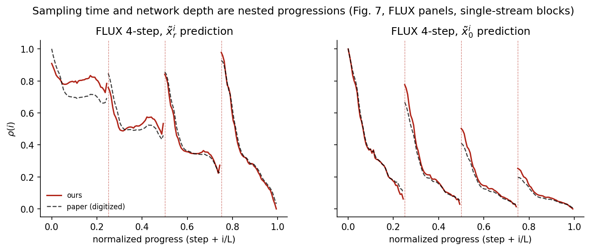
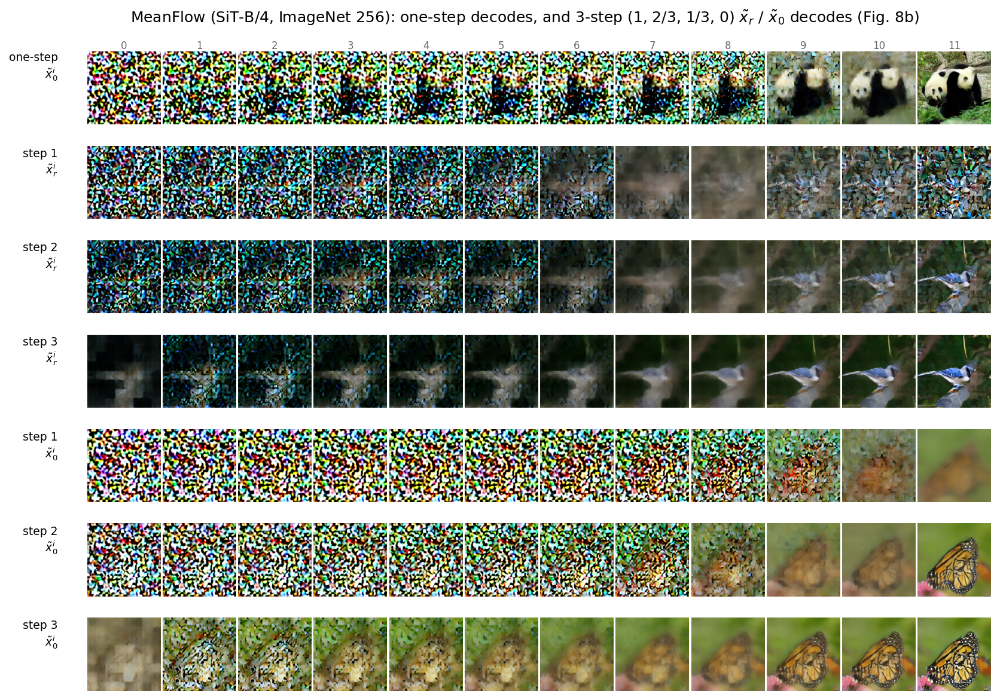
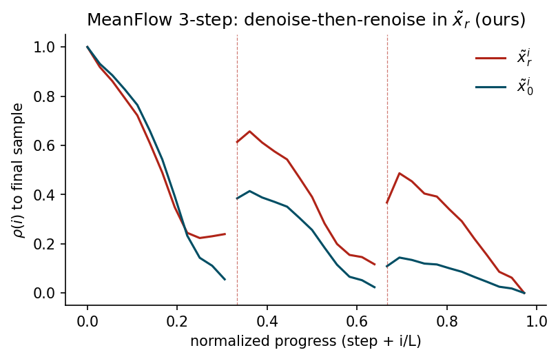
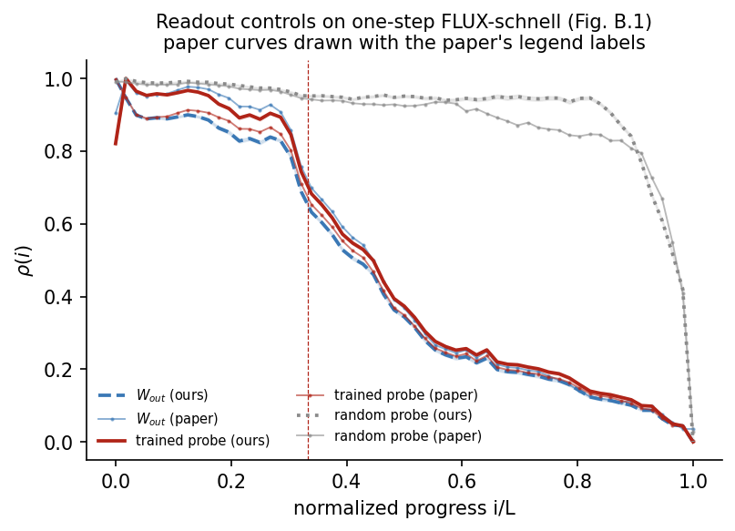
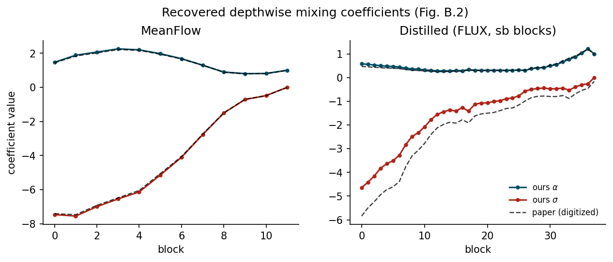
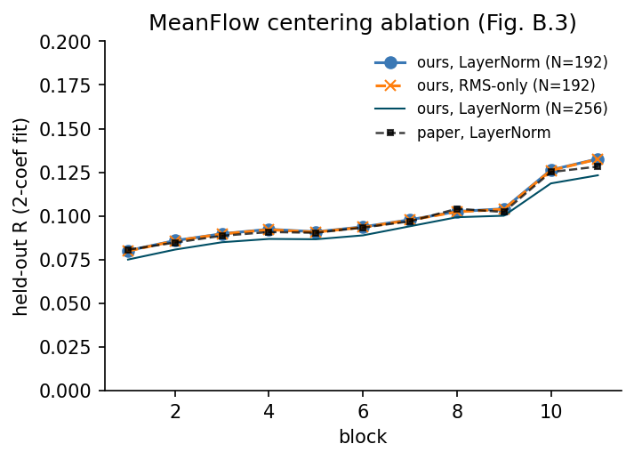

# Reproduction of "Depth as Time in One-Step Generative Models" (arXiv 2610.03626)

This report compares the FLUX.1-schnell and MeanFlow results of the paper with results from this
repository. The paper's numbers come from its text and from curves digitized out of the arXiv
figure files (`paper/latex/figs/*.pdf`). Figures are in `figures/`.

## Setup

| | Paper | This run |
|---|---|---|
| MeanFlow checkpoint | "released B/2" (SiT, ImageNet 256, 12 blocks, width 768) | `MeanFlow-PyTorch/meanflow-B4.pth`, **SiT-B/4** (12 blocks, width 768, patch 4) |
| FLUX | FLUX.1-schnell, 57 blocks (19 db + 38 sb) | same, local HF cache, bf16, **1024x1024** (resolution not given in the paper) |
| rho(i) | 32 examples, L2, per-trajectory max | 32 examples (FLUX: 32 prompts; MeanFlow: random classes), L2 in latent space |
| Mixing fit | 256 trajectories, 179/77 split | same (FLUX: single-stream blocks, L = 38) |
| Multi-step | FLUX 4-step and 2-step; MeanFlow 3-step | FLUX sigmas [1, .75, .5, .25, 0] and [1, .5, 0]; MeanFlow [1, 2/3, 1/3, 0] |

Environment: Python 3.10.12 venv (`.venv` at the repository root, gitignored) with torch 2.8.0
(CUDA 12.8), diffusers 0.36.0, transformers 4.57.6 and timm 1.0.30, on one RTX 6000 Ada. The runs
were first made in the MeanFlow-PyTorch Python 3.9 venv with `zip(strict=True)` temporarily
removed from the package, then repeated in this 3.10 environment with the package unmodified. All
MeanFlow and FLUX outputs (mixing coefficients, held-out R, rho distances) came out bit for bit
the same, except the trained and random probe curves, which moved by at most 0.02% relative
because the probe now runs in float32 (see the code review).

## Results

"pp" means percentage points of rho, which lies in [0, 1]. MAE is mean absolute error over all
plotted points, and r is the Pearson correlation of the curves.

| Quantity | Paper | Ours | Difference |
|---|---|---|---|
| MeanFlow alpha at block 4 | 2.18 (text) | 2.197 | +0.8% |
| MeanFlow sigma at block 4 | -6.04 (text) | -6.132 | 1.5% larger magnitude |
| MeanFlow mean held-out R (N=192, the Fig. B.3 protocol) | ~0.10 (text), 0.099 (figure) | 0.100 | +1.0% |
| MeanFlow alpha curve (12 blocks), Fig. 5 | digitized | | mean 1.5%, max 2.6% per block |
| MeanFlow sigma curve (12 blocks), Fig. 5 | digitized | | mean 1.1%, max 2.0% per block |
| MeanFlow held-out R curve (11 blocks, N=192), Fig. B.3 | digitized | | mean 1.3%, max 3.4% per block |
| Centering ablation, change in mean R (LayerNorm to RMS-only) | -0.17% | -0.19% | same conclusion |
| FLUX one-step rho, W_out vs Fig. 3 | digitized | | MAE 1.1 pp, max 3.3 pp, r = 1.000 |
| FLUX one-step rho, trained probe vs Fig. B.1 (see note 1) | digitized | | MAE 1.3 pp, max 8.4 pp, r = 0.999 |
| FLUX one-step rho, random probe vs Fig. B.1 | digitized | | MAE 3.0 pp, max 10.4 pp, r = 0.977 |
| FLUX 4-step rho of x_r, Fig. 7 (sb blocks, see note 2) | digitized | | MAE 4.1 pp (steps: 8.5 / 4.2 / 1.9 / 1.8), r = 0.975 |
| FLUX 4-step rho of x_0, Fig. 7 (sb blocks) | digitized | | MAE 2.0 pp (steps: 1.3 / 2.6 / 2.4 / 1.5), r = 0.992 |
| FLUX alpha curve (38 sb blocks), Fig. B.2 | digitized | | mean 9.1% per block, r = 0.985 |
| FLUX sigma curve (38 sb blocks), Fig. B.2 | digitized | | **mean 32.9% per block**, r = 1.000 (see note 3) |
| FLUX sigma at sb00 | -5.84 (figure) | -4.64 | 20.6% smaller magnitude |
| FLUX mean held-out R | not reported | 0.131 | - |

The full table, including the alternative readings, is in `summary_table.md`. The raw numbers
are in `comparison.json`.

**Summary.** Every qualitative claim about FLUX-schnell and MeanFlow reproduces:

- progressive refinement across depth;
- a two-term mixing fit with low held-out error;
- coefficients far outside [0, 1];
- the trained probe tracking W_out while the random probe does not;
- each sampler step refining on its own, with x_0 nearly reaching the final image in step 1;
- MeanFlow denoising and then renoising toward a noisy endpoint;
- insensitivity to centering.

MeanFlow numbers agree to within about 1-2%. FLUX rho curves agree to within 1-4 pp. The one
clear quantitative gap is the size of FLUX's sigma coefficients. A code review (below) found
no cause for it in this implementation.

## Notes on differences

1. **Fig. B.1 legend appears swapped.** Our W_out curve matches the curve the paper labels
   "trained probe" (MAE 1.1 pp). Our trained probe matches the curve labelled "W_out"
   (1.3 pp). With the labels as printed, the errors are 4.0 pp and 2.8 pp. The paper's own
   Fig. 3, which shows the W_out curve for FLUX-schnell, uses the same curve as the B.1
   "trained probe". So the B.1 legend is very likely swapped. Either way the conclusion holds:
   both readouts behave alike and the random probe does not.
2. **Fig. 7 uses only the 38 single-stream blocks.** The caption and text do not say so. Over
   all 57 blocks our curves stay flat through the double-stream blocks, and the MAE is
   14.0 pp (x_r) and 9.2 pp (x_0). Over the single-stream blocks only, it drops to 4.1 pp and
   2.0 pp. Fig. 3 and Fig. B.1 do use all 57 blocks: the db/sb boundary sits at 19/57.
3. **FLUX sigma is about 20-40% smaller in magnitude than in the paper, with the same shape**
   (r = 1.000). Alpha agrees better (9%). The paper's final FLUX block has
   alpha = 0.96 and sigma = -0.16. A fit of the last layer against itself must give exactly
   (1, 0), and our fit (and the paper's MeanFlow fit) does. So the paper's FLUX reference
   "final prediction" or noise was probably not exactly the sb37 decode and the input latent
   used here. The section below lists what was tested.
4. **The MeanFlow checkpoint is B/4, not B/2.** Despite this, the coefficients agree to about
   1-2% and the decodes look the same as the paper's, including the 4x4-patch noise texture.
   That suggests the paper may have used this same public checkpoint, but this cannot be
   confirmed.
5. **rho is computed in latent space.** Pixel-space rho (after the VAE) gives a very
   different FLUX curve (24.5 pp MAE), so the paper also measured in latent space.

## Code review: could our code cause the differences?

Each part of the pipeline behind a remaining gap was checked against the installed library code
or tested directly.

**Verified correct**
- MeanFlow adapter: reproduces the original SiT forward exactly (max difference 0.0).
- FLUX adapter against diffusers 0.36: both block types return `(text, image)` tuples, so
  `output[-1]` is the image stream. `norm_out(hidden_states, temb)` is called positionally, so the
  pre-hook captures `temb`. The timestep is passed in [0, 1], as `FluxPipeline` does. The
  last-layer readout equals the transformer output (this is also covered by the unit tests).
- Mixing fit: the closed-form 2x2 normal equations and held-out R match the definition in
  Appendix B.2. Fitting 64 trajectories gives the same coefficients as fitting 256.
- rho: per-trajectory normalization, then averaging, as described in the paper.
- Multi-step: the noise schedule `[1, .75, .5, .25, 0]` matches the scheduler config
  (`shift = 1`, no dynamic shifting). The state is cast to bf16 between steps, as in the pipeline.
- Digitization: the MeanFlow coefficients read from the figure reproduce the paper's text values
  (2.17 / -6.045 vs 2.18 / -6.04), and the last block reads 0.995 / -0.005 against an exact 1 / 0.

**Issues found and fixed**
1. *Comparison protocol (our analysis script).* The paper's Fig. B.3 R curve comes from the N=192
   centering-ablation run, but it had been compared with our N=256 run. Like for like, the mean
   R difference is +1.0% (it was reported as -4.3%), and the per-block difference is 1.3% (was
   4.4%). The remaining gap between the 256 and 192 runs is only a different held-out split.
2. *Probe precision (package, `readouts.py`).* `LinearTokenReadout` applied LayerNorm and the
   probe matrix in bf16 for FLUX, although the probe was fitted in float32. It now runs in
   float32. Re-running the FLUX controls changed the curves by less than 0.01 pp, so this was not
   a source of difference.
3. *Memory bug (package, `text_to_image.py`).* Prompt encoding ran with autograd enabled, which
   made FLUX run out of GPU memory. Fixed during the main run. It did not affect results.

**Experiments run for the FLUX sigma gap.** Each line is the mean error per block against
Fig. B.2.

| Variant | alpha error | sigma error | sigma at sb00 (paper -5.84) |
|---|---|---|---|
| Main run: 1024 px, our 32 prompts, one-step reference | 9.1% | 32.9% | -4.64 |
| 512 px | 28.1% | 34.4% | -4.46 |
| ImageNet-style prompts ("a photo of a ...") | 11.2% | 34.2% | -4.63 |
| Reference = final 4-step sample (64 trajectories) | 8.5% | 31.3% | -4.63 |

A second pass traced the code path behind these rows stage by stage
(`scripts/diagnose_flux_mixing.py`, `scripts/localize_pipeline_gap.py`, 16 trajectories, where
the baseline sigma error is 32.9%):

| Stage tested | Result |
|---|---|
| Adapter vs a raw transformer call with the same inputs | identical (difference 0) |
| Timestep passed as bf16 vs float32 | identical |
| Output head (`norm_out`, `proj_out`) in float32 | coefficients change by at most 0.0004 |
| Whole transformer in float32 (two GPUs) | coefficients change by at most 0.004; sigma error 32.9% |
| Fit with an intercept, or with per-channel / per-token centering | sigma error 32.9% - 33.0% |
| Independent least-squares solve vs the package's streamed fit | same coefficients |

One side finding: our one-step image differs by about 12% (cosine 0.993) from a stock
`FluxPipeline` call with the same noise and prompt. This is not a conditioning bug. The bf16 T5
embedding of a prompt changes by about 3% depending on whether it is encoded alone or in a
batch, and the network amplifies that. It changes the image slightly, not the coefficients.

Sigma is stable across everything above, so the gap does not come from prompts, resolution,
the choice of reference, sampling noise, numerical precision, or the fit convention. No bug was
found in this implementation.

**What the gap looks like.** The paper's coefficients are close to a fixed linear map of ours:
`[alpha', sigma'] = [alpha, sigma] @ [[1.03, -0.26], [0.03, 1.27]]`. Applying it reduces the
sigma error from 33% to 8% and the alpha error from 9% to 2.5%. A fixed map like this is what
two fits produce when they regress on different vectors: here, a noise vector about 0.79 times
ours and a "final prediction" that contains roughly 0.2 of the noise. That matches the paper's
non-trivial last-block fit (0.96, -0.16), and points to an undocumented choice in the paper's
FLUX protocol (which tensors were used as the noise and the final prediction) rather than to a
difference in the model or the probe. With the ImageNet-style prompts, the Fig. 7 step-1 x_r
gap grows (8.5 to 11.8 pp), so that curve does depend somewhat on content.

## Figures

Each figure is ours. The paper's originals are not included in this repository; the figure
number in each heading refers to the [arXiv paper](https://arxiv.org/abs/2610.03626). Where the
paper's figure covers models we did not run (Drifting, Shortcut, SANA-Sprint, the FLUX-dev
teacher, CIFAR-10), those panels have no counterpart here. The paper's panels use its own
prompts, classes and seeds, so the example images differ even where the curves agree. In our
plots the dashed black line is the curve digitized from the paper.

### Fig. 3: depth as time in one-step generators

FLUX.1-schnell (single-stream blocks) and MeanFlow one-step decodes, with the FLUX rho curve. Our rho differs from the paper by 1.1 pp on average. The paper also shows a Drifting row and the FLUX-dev teacher curve.



### Fig. 4: mixing reconstructions

Actual decode, fitted mixture and residual on a held-out trajectory. The paper also has Drifting and Shortcut panels.



### Fig. 5: MeanFlow mixing coefficients

Recovered alpha and sigma per block. Ours differs from the digitized paper values by 1.5% (alpha) and 1.1% (sigma) per block on average. The paper also has a Drifting panel.



### Fig. 6: two-step FLUX endpoint predictions

Endpoint prediction after each single-stream block for the two steps 1 to 0.5 and 0.5 to 0. Step 1 sharpens toward a still-noisy state and step 2 refines to the clean image, in both.



### Fig. 7: sampling time and network depth (FLUX panels)

Four-step FLUX rho for the endpoint and clean predictions, over the 38 single-stream blocks (see note 2). Mean absolute difference: 4.1 pp (x_r) and 2.0 pp (x_0). The SANA-Sprint panels and the teacher curves are not reproduced.



### Fig. 8: MeanFlow denoise-then-renoise

Ours is the ImageNet MeanFlow of panel (b): one-step, three-step endpoint and three-step clean decodes. Panel (a), the CIFAR-10 model, needs a model that is not available here. Our three-step rho curve, which has no counterpart in the paper, follows below.





### Fig. B.1: readout controls on FLUX

W_out, the trained probe and the random probe. The paper's curves are drawn here with the paper's own legend labels, which look swapped (note 1). The curve it labels 'trained probe' is the model's own readout.



### Fig. B.2: mixing coefficients (MeanFlow and FLUX panels)

MeanFlow agrees almost exactly. FLUX has the same shape but a smaller sigma, which is the one clear gap (note 3 and the code review below). Only 2 of the paper's 5 panels are reproduced.



### Fig. B.3: centering ablation (MeanFlow)

Held-out R with LayerNorm and with RMS-only normalization. Ours is the N=192 protocol of the paper and differs by 1.3% per block on average. The paper's right panel is Drifting.



### Extra figures (not in the paper)

| File | Content |
|---|---|
| `figures/extra_meanflow_readout_controls.png` | W_out, trained probe and random probe on MeanFlow |
| `figures/extra_heldout_R_meanflow_flux.png` | held-out R per block for MeanFlow and FLUX |
| `figures/extra_flux_rho_latent_vs_pixel.png` | FLUX rho computed in latent space vs pixel space |

## Not reproduced

These parts need models or training that are not available here:

- Drifting, Shortcut and SANA-Sprint panels: no checkpoints available.
- FLUX-dev teacher curves: FLUX-dev is not in the cache.
- Toy 8-Gaussians example and CIFAR-10 MeanFlow (Fig. 2, Fig. 8a): these need training.
- The compression method of Section 5: out of scope for this repository.

## Rerunning

Requirements: Python 3.10 or newer (the package uses `zip(strict=True)`), plus torch, diffusers,
timm (for the MeanFlow model code), PyMuPDF and Pillow. The versions used are listed under
"Setup". The scripts expect the MeanFlow-PyTorch
repository and checkpoint at the path set in `scripts/common.py`, and the arXiv source of the
paper extracted into `paper/latex/` (download `https://arxiv.org/e-print/2610.03626`). The
paper's bitmaps in `paper_data/raster/` are rebuilt from that source on first use.

```bash
PY=../../.venv/bin/python   # or any Python 3.10+ environment with the requirements above
cd paper_reproduction/scripts
HF_HUB_OFFLINE=1 CUDA_VISIBLE_DEVICES=0 $PY run_meanflow.py      # ~1 min
HF_HUB_OFFLINE=1 CUDA_VISIBLE_DEVICES=0 $PY run_flux.py          # ~15 min at 1024, needs ~30 GB
$PY extract_paper_vector.py                                       # digitize vector plots
$PY extract_paper_raster.py                                       # digitize raster rho plots
$PY make_figures.py        # figures/, comparison.json, sensitivity.json, summary_table.md

# optional: the FLUX sensitivity variants from the code-review section
HF_HUB_OFFLINE=1 CUDA_VISIBLE_DEVICES=0 $PY run_flux.py --size 512 --out-name flux_512 \
    --skip one_step multi_step two_step
HF_HUB_OFFLINE=1 CUDA_VISIBLE_DEVICES=0 $PY run_flux.py --out-name flux_altprompts \
    --prompts-file prompts_imagenet_style.txt --skip one_step two_step
HF_HUB_OFFLINE=1 CUDA_VISIBLE_DEVICES=0 $PY test_flux_reference.py   # 4-step reference test
```

Raw results go to `data/` (about 420 MB, mostly decoded images). Logs are in `logs/`.
The raw results, logs, the paper bitmaps and any copies of the paper's figures are gitignored.
